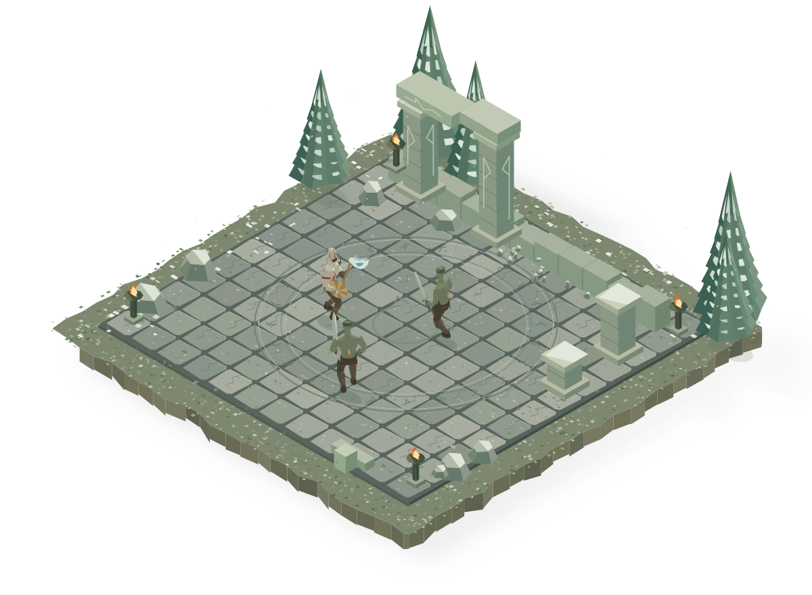

# mini-rpg

[Play the live app](https://rpg-dioramas.vercel.app) · [Source on GitHub](https://github.com/hckmstrrahul/mini-rpg)

Thirteen miniature game worlds, built from SVG and brought to life with vanilla JavaScript. Move, fight, dodge, and use character-specific abilities—or switch to **Video** and watch a choreographed performance.

Built by [Rahul Chakraborty](https://github.com/hckmstrrahul), iterating with Codex on the art, character rigs, combat, and interface.



## How it was built

The project started with one isometric courtyard and an animated character, then grew into a shared rendering and combat system with thirteen distinct environments. The artwork is described in code: paving, trees, architecture, clothing, weapons, rain, and other details are assembled from geometric primitives. Game references informed the silhouettes and materials; the app does not download game models or textures.

The stack is deliberately small:

| Layer | Implementation |
| --- | --- |
| Interface | Semantic HTML, CSS variables, responsive layouts, native buttons |
| Scene renderer | SVG paths and groups generated by plain JavaScript |
| Geometry | World-space points, isometric projection, depth ordering, procedural detail |
| Characters | Shared fixed-length skeletons, two-bone inverse kinematics, planted footsteps |
| Simulation | A fixed 60 Hz update step, rendered with `requestAnimationFrame` |
| Interaction | Keyboard and Pointer Events, multi-touch input, Web Animations API |
| Build and tests | Node.js built-in modules; no npm dependencies |
| Hosting | Static files; no application server, database, or API keys |

### From geometry to a playable world

1. **Build the environment.** Seeded geometry gives each scene repeatable surface variation and detail. Environments are constructed when first visited and retained for later visits.
2. **Advance the simulation.** Input changes movement or starts an action. The combat system handles collisions, enemy AI, stamina, damage, projectiles, cooldowns, and recovery.
3. **Pose the character.** Movement and action state drive the rig. Inverse kinematics places limbs while preserving bone lengths and ground contact.
4. **Project and draw.** Three-dimensional points are projected into an isometric two-dimensional SVG. The browser paints the resulting shapes.
5. **Animate the interface separately.** Scene transitions, sliding selection pills, dropdowns, and touch feedback use CSS and the Web Animations API. Reduced-motion preferences replace large scene transitions with fades.

**Video mode is rendered live too.** It is not an embedded video or a downloaded MP4. God of War uses authored choreography; the additional scenes cache simulated performance frames on demand and render them through the same SVG pipeline.

HTML provides the interface structure, CSS its appearance, and JavaScript the simulation and procedural animation. Removing JavaScript would leave a static presentation rather than this interactive game.

## What makes it lightweight

There is no framework bundle, game-engine download, model loader, raster texture pack, external font, or runtime service. Every world uses the same renderer and rig infrastructure. Only the active scene is animated; neighboring scenes use static SVG previews.

The app still has detailed artwork, so “zero dependencies” does not mean “zero download.” The preview files are the largest part of its network payload.

Measured from the source files with `npm run size`:

| Payload | Uncompressed | Gzip estimate |
| --- | ---: | ---: |
| All runtime HTML, CSS, and JavaScript | 337 KiB | 116.5 KiB |
| The initial two neighboring previews | 2.74 MiB | 729 KiB |
| Initial page plus those two previews | About 3.07 MiB | About 846 KiB |
| All thirteen previews, across the whole collection | 14.74 MiB | 3.61 MiB |

These estimates compress each file separately at gzip level 6. Actual transfer depends on the host's compression and browser cache. The full preview collection is **not fetched on first load**: the previous and next preview images change as you browse.

The optional `artwork-exports/` and `trailer-production/` folders can contain hundreds of megabytes or gigabytes of production material. They are ignored by Git, excluded from deployment uploads, and never requested by the app. **Visitors do not download those files to play.**

Detailed SVG scenes still consume browser CPU and memory, particularly as more worlds are visited. This is a compact, dependency-free architecture—not a claim that every scene runs at a fixed frame rate on every device.

## Play

Desktop opens in **Game** mode. Mobile and tablet layouts open in **Video** mode; selecting Game reveals a bottom sheet with a direction pad and action buttons styled like the keyboard keys.

| Input | Action |
| --- | --- |
| WASD / arrow keys | Move in screen-relative directions |
| J | Primary attack / combo |
| K | Secondary action |
| L | Special ability |
| Space | Dodge |
| Hold Shift | Guard / defensive action |
| R | Restart the fight |
| − / + | Zoom |
| 0 | Recenter and reset zoom |
| Escape / P in Video | Pause or resume |

On touch screens, hold or slide across the direction pad to move, including diagonally. Use another finger to attack or hold guard. The L button shows its remaining cooldown. The `?` menu explains the selected character's moves and special-action costs.

At 75–100% zoom, drag horizontally on desktop or swipe vertically on mobile/tablet to switch scenes after moving at least a quarter of the scene area. Short drags return to center. Tap a neighboring preview to select it; the collection wraps in a circle. Above 100%, dragging pans the scene. Scene changes retain each fight, selected mode, and zoom during the current visit.

The compact layout applies at widths up to 1024 px, and up to 1366 px for a coarse primary pointer. Short landscape screens place the controls beside the scene. A deliberately selected mode survives resizing.

## Worlds and signature moves

| World | J | K | L |
| --- | --- | --- | --- |
| God of War | Axe combo | Returning axe | Frost slam |
| Ghost of Tsushima | Katana combo | Kunai volley | Heavenly strike |
| Batman: Arkham | Punch combo | Batarang | Grapnel takedown |
| Assassin's Creed | Sword combo | Throwing knife | Hidden-blade lunge |
| Prince of Persia | Scimitar combo | Dagger cast | Rewind |
| Call of Duty | Rifle burst | Frag grenade | Sliding burst |
| Max Payne | Dual pistols | Shootdodge | Six-second Bullet Time |
| GTA V | Carbine burst | Grenade | Red Mist |
| Spider-Man | Acrobatic combo | Web snare | Directional web travel |
| Black Myth: Wukong | Staff combo | Immobilize | Pillar smash |
| Rainbow Six Siege | Rifle burst | Stun grenade | Breaching hammer |
| Fable III | Sword flourish | Flintlock | Fire and lightning |
| Mortal Kombat | Punch / uppercut combo | Spear pull | Hellport |

Each world has its own architecture, costumes, effects, and interface palette. Max Payne's Bullet Time slows the simulation—including the hero, bullets, opponents, rain, and turbine fan—while its six-second duration uses real time.

## Run locally

Use Node.js 24 or later for the build and tests, and Python 3 for the supplied local server. There are no packages to install.

```sh
git clone https://github.com/hckmstrrahul/mini-rpg.git
cd mini-rpg
npm start
```

Open [localhost:4181](http://127.0.0.1:4181). You can also serve `app/` with any static HTTP server.

```sh
npm test                  # Rig, gameplay, UI, and color-contrast checks
npm run build             # Regenerate navigation previews
npm run size              # Report runtime and preview payload sizes
npm run audit:contrast    # Regenerate the contrast report
```

The previews are committed, so a fresh checkout can run immediately. Rebuild them after changing environment or character artwork.

## Source map

```text
mini-rpg/
├── app/                 # The complete deployed application
│   ├── index.html       # Shared UI and semantic controls
│   ├── scene.js         # Projection, geometry, rigs, original choreography
│   ├── game.js          # Shared movement, combat, collision, and AI
│   ├── worlds.js        # Catalog, scene variants, environment switching, Video frames
│   ├── world-*.js       # Four additional environments and character sets
│   ├── legend-*.js      # Eight expansion worlds, characters, and combat variants
│   ├── player.js        # Input, playback, camera, navigation, and touch controls
│   ├── scene-palettes.js
│   ├── ui-motion.css
│   ├── compact-ui.css
│   └── assets/          # Static neighboring-scene previews only
├── scripts/             # Preview builds, optional SVG exports, size report
├── tests/               # Rig, gameplay, and controller regression tests
├── audits/              # Contrast audit and generated report
├── docs/licenses/       # Third-party notices
├── package.json
└── vercel.json          # Static deployment settings
```

The local-only `artwork-exports/` and `trailer-production/` directories are intentionally absent from the public repository.

## Validation

`npm test` checks rigid bone lengths, foot placement, weapon orientation, attack contacts, projectile timing, collisions, enemy behavior, cooldowns, animation loops, and per-scene action labels. Controller checks cover keyboard and multi-touch input, cleanup after interruption, horizontal and vertical scene navigation, circular wraparound, scroll inertia, and reduced motion. The contrast audit covers all thirteen palettes.

Browser checks have also exercised portrait and landscape layouts, touch movement plus attacks, preview taps, zoomed panning, and scene transitions. Touch emulation is not a substitute for testing performance and browser chrome on physical phones.

## Deploy

The production site is [rpg-dioramas.vercel.app](https://rpg-dioramas.vercel.app). Vercel is connected to this repository; pushes to `main` run the checks and publish a new production deployment.

Import this repository into Vercel with the repository root as the project root. The committed configuration selects a static build, runs `npm test && npm run build`, and publishes **only `app/`**. No environment variables or server functions are needed.

The same `app/` directory can be hosted on another static host. For the configuration fields, see [Vercel's `vercel.json` documentation](https://vercel.com/docs/project-configuration/vercel-json).

Optional standalone animated SVGs can be generated locally with `npm run export:svg`. These are frame-sampled artwork exports, can be large, and are unrelated to what the live app downloads.

## Credits

This is a fan-art coding experiment. Game and character names belong to their respective owners; it is not an official release or affiliated with those studios. The geometry is generated by this project's code rather than extracted from the original games.

Dropdown and sliding-tab CSS in `app/ui-motion.css` is adapted from [Transitions.dev](https://github.com/Jakubantalik/transitions.dev) by Jakub Antalik. Its original attribution is retained; the upstream license is included in [docs/licenses/transitions-dev.txt](docs/licenses/transitions-dev.txt).
