# rpg-diorama

Thirteen miniature game worlds drawn with SVG and animated with vanilla JavaScript. Move, fight and try each character's abilities, or switch to **Video** to watch a live animated performance.

[Play in your browser](https://rpg-diorama.vercel.app) · [Watch the 4K showcase](https://www.youtube.com/watch?v=CLH_EomM030) · [Development guide](docs/DEVELOPMENT.md)

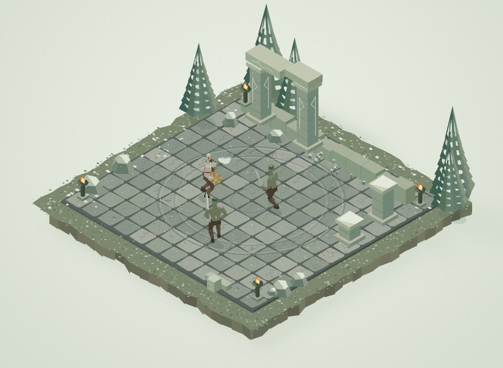

## Run locally

Requires **Node.js 24+** and **Python 3**. There are no npm packages to install.

```sh
git clone https://github.com/hckmstrrahul/rpg-diorama.git
cd rpg-diorama
npm start
```

Open [127.0.0.1:4181](http://127.0.0.1:4181).

## Play

| Control | Action |
| --- | --- |
| `WASD` / arrow keys | Move |
| `J` / `K` / `L` | Attack / secondary action / special ability |
| `Space` / hold `Shift` | Dodge / defend |
| `R` | Restart |
| `−` / `+` / `0` | Zoom out / zoom in / reset view |

Open **?** for character-specific moves and cooldowns. Use the arrows or scene menu to change games. On desktop, drag at default zoom to switch scenes; zoom in to pan. Mobile and tablet start in Video mode: choose **Game** for touch controls, drag to pan and pinch to zoom.

<details>
<summary>All 13 scenes</summary>

<table>
  <tr>
    <td align="center" width="50%"><strong>God of War</strong><br>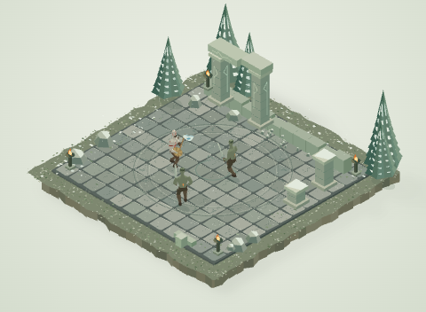</td>
    <td align="center" width="50%"><strong>Ghost of Tsushima</strong><br>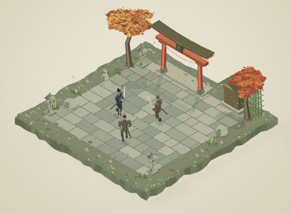</td>
  </tr>
  <tr>
    <td align="center" width="50%"><strong>Batman: Arkham</strong><br>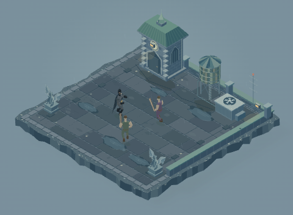</td>
    <td align="center" width="50%"><strong>Assassin’s Creed</strong><br>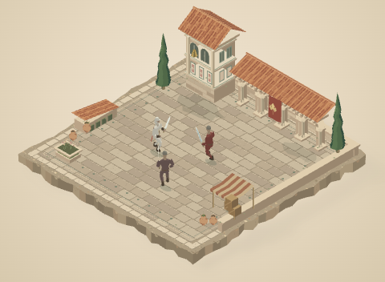</td>
  </tr>
  <tr>
    <td align="center" width="50%"><strong>Prince of Persia</strong><br>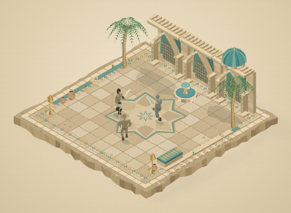</td>
    <td align="center" width="50%"><strong>Call of Duty</strong><br>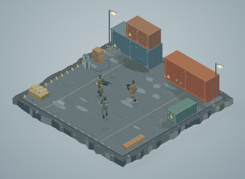</td>
  </tr>
  <tr>
    <td align="center" width="50%"><strong>Max Payne</strong><br>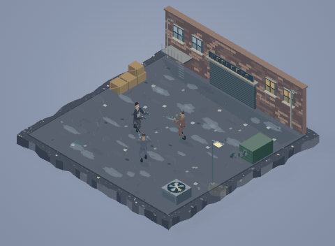</td>
    <td align="center" width="50%"><strong>GTA V</strong><br>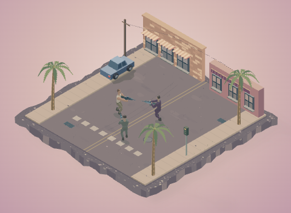</td>
  </tr>
  <tr>
    <td align="center" width="50%"><strong>Spider-Man</strong><br>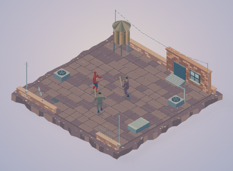</td>
    <td align="center" width="50%"><strong>Black Myth: Wukong</strong><br>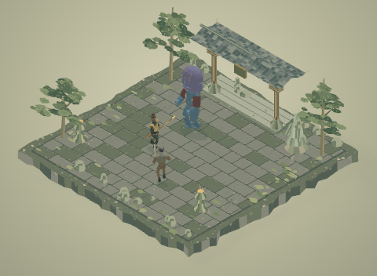</td>
  </tr>
  <tr>
    <td align="center" width="50%"><strong>Rainbow Six Siege</strong><br>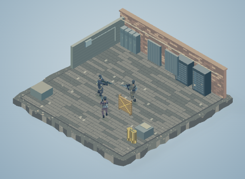</td>
    <td align="center" width="50%"><strong>Fable III</strong><br>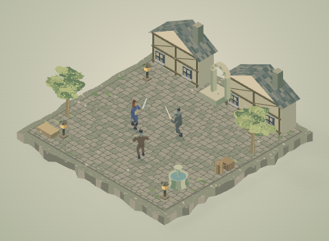</td>
  </tr>
  <tr>
    <td align="center" width="50%"><strong>Mortal Kombat</strong><br>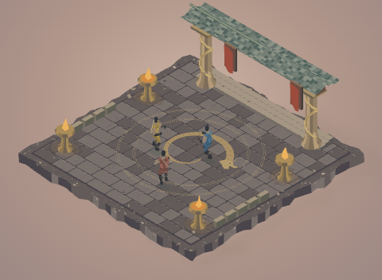</td>
    <td></td>
  </tr>
</table>

</details>

## Development

The app has **zero runtime dependencies**. Shared JavaScript rigs, combat and effects animate SVG scenes; Video mode renders in the browser too. README media and the optional YouTube showcase are separate from the app.

| Command | Purpose |
| --- | --- |
| `npm test` | Check character rigs, gameplay, spatial behavior and contrast. |
| `npm run build` | Regenerate the scene previews. |
| `npm run size` | Report current compressed download sizes. |
| `npm run export:svg` | Generate SVG exports. |

The [development guide](docs/DEVELOPMENT.md) explains source files, architecture and static deployment. Built with Codex CLI; the showcase was captured and edited with FFmpeg.

## Credits


An unofficial fan-art coding experiment. Game and character names belong to their owners; the artwork is generated by this project’s code.

Dropdown, tab, and modal motion is adapted from [Transitions.dev](https://github.com/Jakubantalik/transitions.dev) by Jakub Antalik. [License](docs/licenses/transitions-dev.txt).
