# rpg-diorama

Tiny, lightweight role playing games; SVG, vanilla JS.

**[Play in your browser](https://rpg-diorama.vercel.app)** · [Development guide](docs/DEVELOPMENT.md)

Explore 13 miniature game worlds. Move, fight, and use each character’s signature abilities, or switch to **Video** to watch an animated performance. Supports keyboard and touch controls.

<a href="https://rpg-diorama.vercel.app">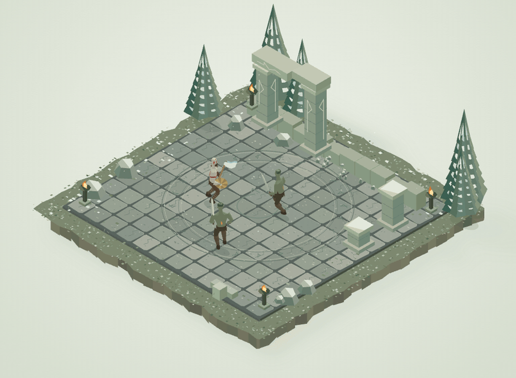</a>

## Scenes

<table>
  <tr>
    <td align="center" width="50%"><strong>God of War</strong><br>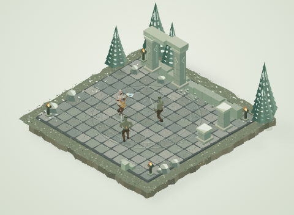</td>
    <td align="center" width="50%"><strong>Ghost of Tsushima</strong><br>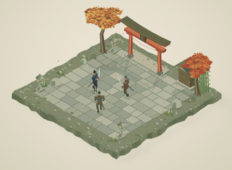</td>
  </tr>
  <tr>
    <td align="center" width="50%"><strong>Batman: Arkham</strong><br>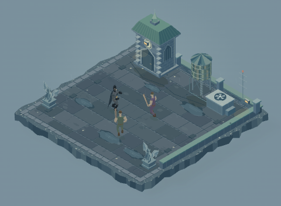</td>
    <td align="center" width="50%"><strong>Assassin’s Creed</strong><br>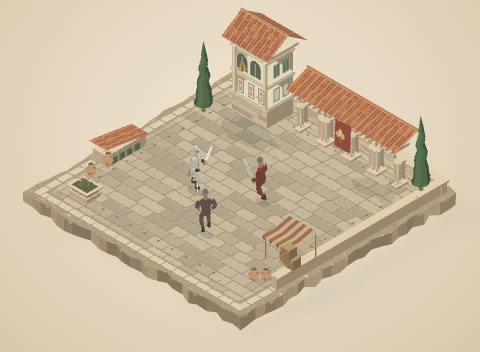</td>
  </tr>
  <tr>
    <td align="center" width="50%"><strong>Prince of Persia</strong><br>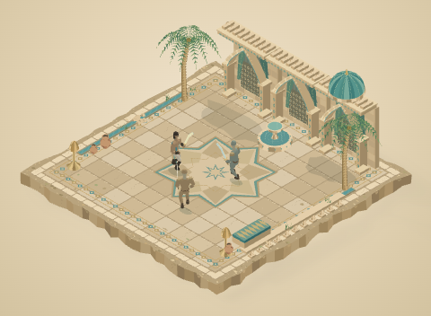</td>
    <td align="center" width="50%"><strong>Call of Duty</strong><br>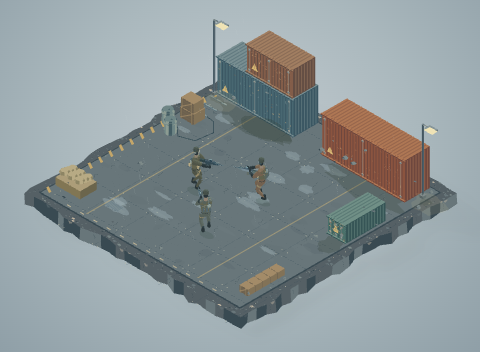</td>
  </tr>
  <tr>
    <td align="center" width="50%"><strong>Max Payne</strong><br>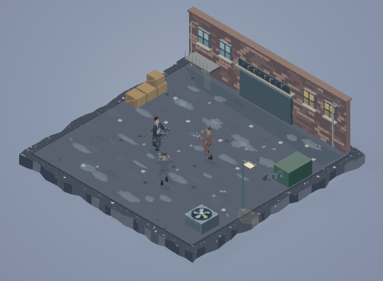</td>
    <td align="center" width="50%"><strong>GTA V</strong><br>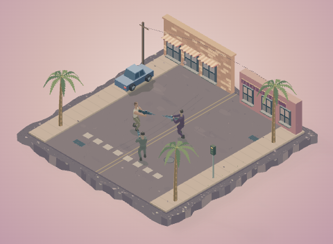</td>
  </tr>
  <tr>
    <td align="center" width="50%"><strong>Spider-Man</strong><br>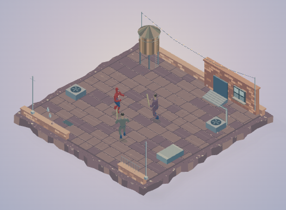</td>
    <td align="center" width="50%"><strong>Black Myth: Wukong</strong><br>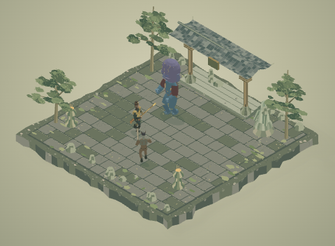</td>
  </tr>
  <tr>
    <td align="center" width="50%"><strong>Rainbow Six Siege</strong><br>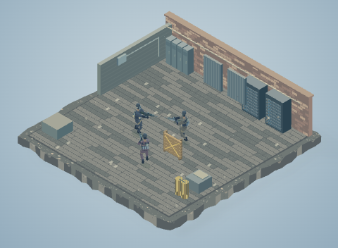</td>
    <td align="center" width="50%"><strong>Fable III</strong><br>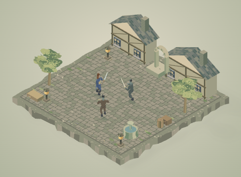</td>
  </tr>
  <tr>
    <td align="center" width="50%"><strong>Mortal Kombat</strong><br>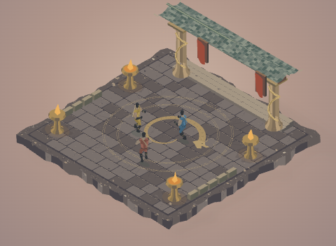</td>
    <td></td>
  </tr>
</table>

## Video

<a href="https://www.youtube.com/watch?v=CLH_EomM030"></a>

[Watch the 4K showcase on YouTube](https://www.youtube.com/watch?v=CLH_EomM030).

Built with Codex CLI: iterating on SVG artwork, character rigs, combat, and UI, checking changes in the browser, then capturing and editing the showcase with FFmpeg.

## Play

| Controls | Action |
| --- | --- |
| WASD / arrow keys | Move |
| J / K / L | Attack / secondary action / special ability |
| Space / hold Shift | Dodge / defend |
| R | Restart |
| − / + / 0 | Zoom out / zoom in / reset view |

Open **?** for character-specific moves and cooldowns. Mobile and tablet start in Video mode; choose **Game** for touch controls. Use the arrows or scene menu to change games, drag to pan, and pinch to zoom. On desktop, drag at default zoom to change scenes; zoom in to pan.

## How it works

HTML and CSS provide the interface. Vanilla JavaScript generates SVG geometry and animates shared character rigs, combat, and effects. Video mode also renders live in the browser.

**Zero runtime dependencies.** Runtime code is about **123 KiB gzipped**. Desktop's initial page includes two neighboring previews, bringing it to about **854 KiB**; mobile and tablet skip those previews. These are compression estimates. README media and trailer exports are separate from the app. The optional YouTube showcase loads only when opened.

## Run locally

Requires Node.js 24+ and Python 3. No packages to install.

```sh
git clone https://github.com/hckmstrrahul/rpg-diorama.git
cd rpg-diorama
npm start
```

Open [localhost:4181](http://127.0.0.1:4181).

Use `npm test` to run checks, `npm run build` to regenerate previews, and `npm run size` to inspect download sizes. See the [development guide](docs/DEVELOPMENT.md) for architecture, source files, and deployment.

## Credits

An unofficial fan-art coding experiment. Game and character names belong to their owners; the artwork is generated by this project’s code.

Dropdown, tab, and modal motion is adapted from [Transitions.dev](https://github.com/Jakubantalik/transitions.dev) by Jakub Antalik. [License](docs/licenses/transitions-dev.txt).
